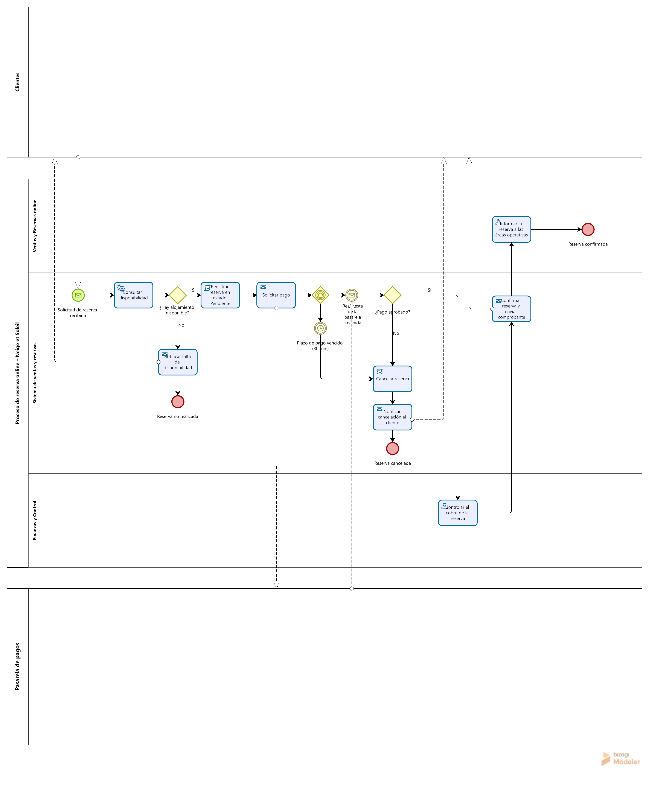

# Sistema de Ventas y Reservas Online – Neige et Soleil

Trabajo Práctico Integrador (TPI) – Organización Empresarial
Tecnicatura Universitaria en Programación a Distancia – Universidad Tecnológica Nacional

## Descripción del sistema

Sistema web de ventas y reservas online para el área de Comercialización de Neige et Soleil,
empresa de estadías educativas y colonias de vacaciones ubicada en Val-Cenis, Francia.
El sistema permite a familias, escuelas y colonias consultar la disponibilidad de alojamientos,
realizar reservas y pagarlas online, y organiza la información de las reservas para el resto
de las áreas de la organización.

## Gestión del proyecto

- Tablero ágil (GitHub Projects): [Backlog TPI – Neige et Soleil](LINK_DEL_TABLERO)
- El backlog contiene las tres historias de usuario del sistema (HU1, HU2 y HU3), cargadas como issues del repositorio, con seguimiento de sus estados: Por hacer, En progreso y Listo.
- Los cambios de la documentación se integraron mediante ramas secundarias y Pull Requests. La revisión de los Pull Requests fue realizada por la propia autora por tratarse de un trabajo individual; los comentarios y correcciones quedan documentados en cada PR.

## Mecanismos de control

Para la auditoría técnica del sistema se definen los siguientes indicadores, con su estándar de desempeño y su frecuencia de medición. Varios retoman las metas cuantitativas de la Entrega N.º 2.

| Indicador | Qué mide | Estándar de desempeño | Frecuencia |
|---|---|---|---|
| Tiempo de respuesta | Carga del catálogo y confirmación de una reserva | 3 segundos o menos en el 95 % de las solicitudes (meta M2) | Semanal |
| Disponibilidad | Porcentaje del tiempo en que el sistema está en línea | 99 % o más | Mensual |
| Capacidad | Usuarios simultáneos sin pérdida de rendimiento | 100 usuarios simultáneos (meta M3) | Antes de cada temporada alta |
| Pagos rechazados por fallas técnicas | Pagos que fallan por errores del sistema o de la pasarela, sobre el total | 2 % o menos | Semanal |
| Reservas canceladas por vencimiento | Reservas en estado Pendiente que pasan a Cancelada por vencer el plazo de pago | 15 % o menos | Mensual |
| Calidad del software | Casos de prueba aprobados y errores críticos sin resolver | 95 % o más de casos aprobados y 0 errores críticos (meta M5) | Antes de cada nueva versión |

Los indicadores de pagos rechazados y de reservas canceladas por vencimiento miden directamente las excepciones modeladas en el BPMN.

## Declaración de Uso de IA

Para esta entrega se utilizó Claude (Anthropic) como asistente de Inteligencia Artificial Generativa. A continuación se detallan los principales prompts, su propósito y las correcciones realizadas por la autora.

| Prompt (resumen) | Propósito | Resultado y corrección humana |
|---|---|---|
| "Ayudame a hacer esta entrega del trabajo integrador" (con la consigna y el material de la Unidad 5) | Interpretar la consigna y organizar las tareas | La IA propuso agregados que la consigna no pedía (máquina de estados, indicadores adicionales). La autora decidió limitar el trabajo estrictamente a lo solicitado. |
| Envío de las Entregas 1, 2 y 3 | Mantener la coherencia con lo ya aprobado | La IA asumió que las historias de usuario estaban definidas en la Entrega 3. La autora verificó la consigna de esa entrega, confirmó que no se habían pedido y se definieron en esta entrega. |
| Pedido de la estructura del BPMN | Obtener una base de pools, lanes, tareas y compuertas | La autora dibujó el diagrama en Bizagi, ajustó el orden de los lanes y corrigió un flujo de mensaje que no llegaba al evento correspondiente. |
| Consulta sobre la revisión de pares del Pull Request | Resolver cómo cumplir la revisión trabajando sola | La IA recomendó conseguir un revisor externo. La autora aportó la indicación del docente para realizar una autorrevisión documentada, que fue la opción adoptada. |
| Pedido de pasos para Git, GitHub y GitHub Projects | Guía para crear el repositorio, las ramas, el PR y el tablero | La autora ejecutó cada paso y verificó los resultados en la plataforma. |

La IA se usó como guía y para generar borradores. Las decisiones sobre el alcance, la elaboración del diagrama y la verificación del contenido fueron de la autora, que es responsable de la versión final.

Enlace de la conversación: [LINK_DE_LA_CONVERSACIÓN](https://claude.ai/share/4a3ec606-3ddd-4afa-8a00-57ff1dbcaffc)

## Integrantes

- Eugenia Avila Ruiz

## Proceso de negocio (BPMN)

El diagrama modela el proceso de reserva online que automatiza el sistema. Se organiza en tres pools: Cliente y Pasarela de pago, como participantes externos, y Neige et Soleil, con tres lanes: Ventas y Reservas online, Sistema de ventas y reservas (comportamiento automatizado) y Finanzas y Control.

El flujo estándar va desde la solicitud de reserva hasta su confirmación. Las excepciones se resuelven mediante compuertas: falta de disponibilidad, pago rechazado y vencimiento del plazo de pago, este último con una compuerta basada en eventos y un temporizador de 30 minutos.

Los estados de la reserva (Pendiente, Confirmada y Cancelada) coinciden con los valores del campo `estado` de la entidad Reserva del diccionario de datos (Entrega N.º 3).
